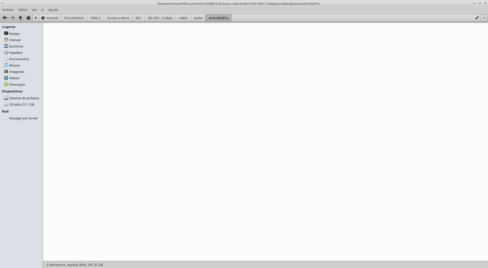
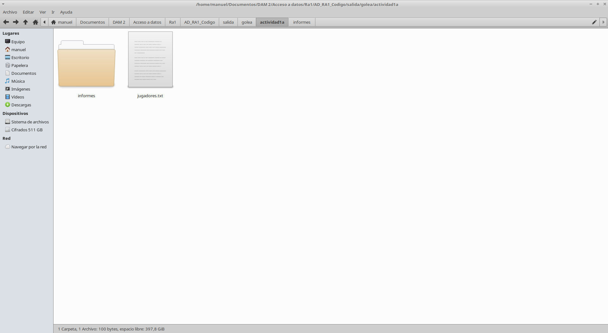
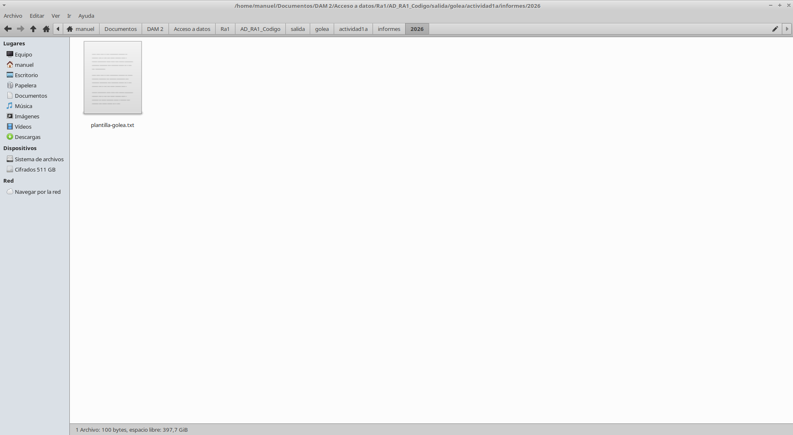
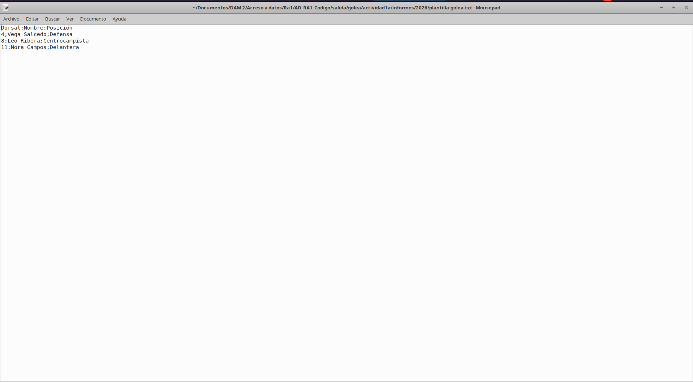
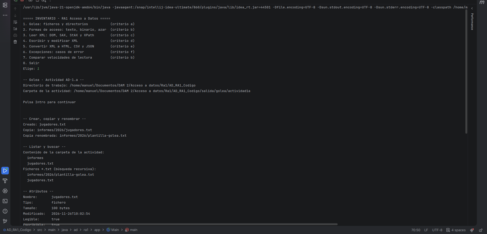
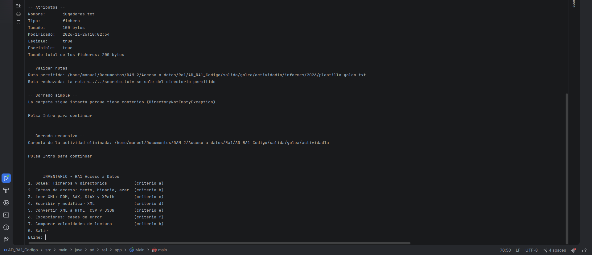

# Golea · Práctica de Acceso a Datos

**Alumno** · Manuel Rojo Rabadán  
**Curso** · 2.º DAM

Golea es una práctica de gestión de un club de fútbol con datos ficticios. He partido del proyecto de inventario que acompaña al *Manual guiado RA1 · Acceso a Datos (ficheros y XML)*. La adaptación que he realizado corresponde a la opción 1 del menú. Las demás opciones siguen siendo ejemplos del proyecto de referencia.

## Ejecución

1. Abrir [`pom.xml`](pom.xml) como proyecto Maven en IntelliJ IDEA y recargar el proyecto con **Load Maven Changes** para resolver las dependencias.
2. Ejecutar [`ad.ra1.app.Main`](src/main/java/ad/ra1/app/Main.java) con la raíz del proyecto como directorio de trabajo (*Working directory*). Es la carpeta donde están el README y el `pom.xml`.
3. Elegir `1` para la demostración de Golea. El menú espera Intro en cada una de las tres pausas. Al volver al menú, la opción `0` cierra la aplicación.

IntelliJ tiene configurado el JDK 21 y Maven compila para Java 21 según el `pom.xml`. El programa usa la biblioteca estándar de Java y JUnit 6.1.3 se utiliza solo en las pruebas. Los archivos generados se guardan en `salida/`, excluida de Git salvo su archivo `.gitkeep`. Las capturas se guardan en `evidencias/`, en la raíz del proyecto.

## Índice

- [a) Gestión de ficheros y directorios](#a-gestión-de-ficheros-y-directorios)
- [b) Formas de acceso a ficheros](#b-formas-de-acceso-a-ficheros)
- [c) Lectura de XML](#c-lectura-de-xml)
- [d) Escritura y modificación de XML](#d-escritura-y-modificación-de-xml)
- [e) Conversión de XML a otros formatos](#e-conversión-de-xml-a-otros-formatos)
- [f) Gestión de excepciones](#f-gestión-de-excepciones)
- [g) Pruebas y documentación](#g-pruebas-y-documentación)

## a) Gestión de ficheros y directorios

He adaptado la opción 1 para crear y organizar en disco una plantilla ficticia del club. [`Main`](src/main/java/ad/ra1/app/Main.java) ordena los pasos en `demoFicheros` y usa el mismo `Scanner` para el menú y las pausas. [`GestorFicheros`](src/main/java/ad/ra1/ficheros/GestorFicheros.java) se encarga de las operaciones. `Path` representa una ruta en memoria y `Files` realiza las operaciones en el sistema de ficheros.

### Preparación de la carpeta

La demostración crea `salida/golea/actividad1a` con `crearDirectorio` y muestra su ruta absoluta. Como `salida/` es una ruta relativa, su ubicación depende del directorio de trabajo. Si la carpeta ya contiene datos, la demostración termina y conserva su contenido. La primera pausa llega cuando la carpeta está vacía.

En el explorador se ve la carpeta `actividad1a` vacía.

### Creación, copia y consulta

La aplicación crea `informes/2026` y usa `crearFichero` para preparar `jugadores.txt`. Los dorsales, nombres y posiciones ficticios se guardan primero en un `String` en memoria. `Files.writeString` los escribe en disco en UTF-8. Después, `copiar` deja una copia en `informes/2026` y `mover` la renombra a `plantilla-golea.txt`. Ambos métodos aceptan un parámetro para permitir la sobrescritura, que en esta demostración está desactivada.

En la carpeta de la actividad aparecen el fichero original `jugadores.txt` y el directorio `informes`.

Dentro de `informes/2026` se ve la copia con el nombre `plantilla-golea.txt`.

Al abrir la copia se ven la cabecera y los tres registros de la plantilla, con el dorsal, el nombre y la posición.

`listar` devuelve las entradas directas de la carpeta ordenadas por nombre. El `DirectoryStream` que se usa para obtenerlas se cierra automáticamente con `try-with-resources`. `buscarRecursivo` entra en los subdirectorios y compara cada nombre de fichero con el patrón `*.txt`. Así aparecen tanto el original como la copia renombrada. `describir` muestra el nombre, tamaño, fecha de modificación y si el original se puede leer y escribir. `tamanoTotal` suma en bytes los tamaños de los dos ficheros. La búsqueda y la suma omiten los enlaces simbólicos.

En la consola de IntelliJ se ven la creación de `jugadores.txt`, el nombre de la copia antes y después de renombrarla, y los dos ficheros encontrados con `*.txt`.

### Validación de rutas y borrado

`resolverSeguro` acepta la ruta interna `informes/2026/plantilla-golea.txt` y rechaza `../../secreto.txt` sin abrir el fichero. `normalize` simplifica componentes como `..` y `startsWith` comprueba que la ruta resultante sigue dentro de la carpeta permitida. Esas dos operaciones comparan rutas. Para detectar enlaces simbólicos, el método comprueba por separado los componentes existentes.

`eliminar` puede borrar un fichero o un directorio vacío. Al probarlo con `actividad1a` llena, lanza `DirectoryNotEmptyException`, un tipo de `IOException`. El bloque `catch` muestra el fallo esperado y permite que la demostración continúe. En la segunda pausa, los dos ficheros siguen en disco y la consola muestra las operaciones realizadas hasta ese punto.

Tras la segunda pausa, `eliminarRecursivo` borra primero el contenido de cada directorio y después el directorio vacío. Si encuentra un enlace simbólico, borra el enlace. En la tercera pausa, la consola ya muestra la confirmación del borrado de `actividad1a`.

En el explorador se ve la carpeta `salida/golea` vacía tras la limpieza.

En la salida final de IntelliJ se ven los 200 bytes que suman los dos ficheros, la ruta interna aceptada, el rechazo de `../../secreto.txt` y el mensaje de que el borrado simple deja la carpeta intacta. Después aparece la confirmación de que el borrado recursivo ha eliminado `actividad1a`.

### Comprobaciones

- **Ejecución por terminal.** Comprobé en una carpeta temporal que la primera pausa deja la carpeta vacía, que la copia renombrada coincide con el original y que la tercera pausa llega con `actividad1a` eliminada. También comprobé que se rechaza la ruta que sale de la carpeta y que, si hay un archivo previo, la demostración se detiene y lo conserva.
- **Maven.** Con Java 21, las 10 pruebas de [`GestorFicherosTest`](src/test/java/ad/ra1/GestorFicherosTest.java) terminaron sin fallos, errores ni omisiones. Comprueban, entre otras operaciones, la sobrescritura al copiar, la búsqueda recursiva, el cálculo del tamaño y el rechazo de rutas externas.

  `mvn -o -Dtest=GestorFicherosTest test`
- **IntelliJ IDEA.** Revisé la configuración del JDK. El resultado de las pruebas indicado arriba corresponde a Maven. Para repetirlas desde el IDE se puede abrir `GestorFicherosTest` y usar **Run**.

## b) Formas de acceso a ficheros

Pendiente de adaptar a Golea.

## c) Lectura de XML

Pendiente de adaptar a Golea.

## d) Escritura y modificación de XML

Pendiente de adaptar a Golea.

## e) Conversión de XML a otros formatos

Pendiente de adaptar a Golea.

## f) Gestión de excepciones

Pendiente de desarrollar como actividad propia de Golea.

## g) Pruebas y documentación

Pendiente de desarrollar como apartado general. Las comprobaciones realizadas para AD-1.a figuran en el apartado a.
